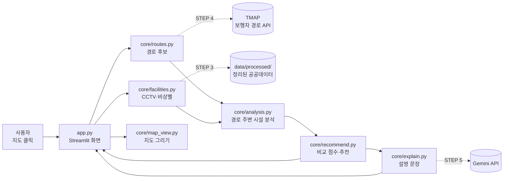

# 안심길(SafeWay) 설계 문서 — STEP 1

## 1. 전체 구성도



점선은 아직 연결 전인 외부 서비스예요. 연결 전에는 각 모듈이 **데모(가상) 데이터**를 쓰고, 화면 상단 배너에 무엇이 가상인지 표시해요.

## 2. 폴더 구조

```
safeway/
├── app.py                  메인 화면 (화면 배치와 버튼 동작만 담당)
├── core/                   실제 기능은 전부 여기
│   ├── config.py           설정값 (지도 중심, 반경, 색상, 파일 경로)
│   ├── texts.py            화면 문구 ← 코딩 몰라도 수정 가능
│   ├── geo.py              미터 단위 거리 계산
│   ├── routes.py           경로 후보 만들기 (데모 / TMAP)
│   ├── search.py           장소 이름 → 좌표 (TMAP 장소 검색, 부산대 반경 10km)
│   ├── facilities.py       시설 데이터 읽기 (공공데이터 / 데모)
│   ├── analysis.py         경로 반경 안 시설 수, 밀도, 공백 구간
│   ├── recommend.py        비교 점수와 추천 (규칙 기반)
│   ├── explain.py          설명 문장 (기본 설명 / Gemini)
│   ├── map_view.py         folium 지도 그리기 (브이월드/OSM)
│   ├── tmap_map.py         TMAP 웹 지도 부품 (Python 쪽)
│   ├── tmap_component/     TMAP 웹 지도 부품 (HTML·JS 화면)
│   └── ui.py               CSS와 카드 디자인
├── data/
│   ├── raw/                원본 CSV (GitHub에 안 올림)
│   └── processed/          정리된 CSV (앱이 읽는 파일)
├── scripts/build_facilities.py  공공데이터 정리 (원본 CSV → 앱용 CSV)
├── tests/                  자동 테스트
├── docs/ARCHITECTURE.md    이 문서
├── .streamlit/config.toml  화면 테마
├── .streamlit/secrets.toml.example  API 키 양식 (실제 키 파일은 안 올림)
├── requirements.txt        필요한 패키지
└── README.md               실행 방법
```

## 3. 모듈끼리 주고받는 데이터 형식

| 이름 | 형식 | 만드는 곳 → 쓰는 곳 |
|---|---|---|
| 좌표 | `(위도, 경도)` 튜플 | 지도 클릭 → 전부 |
| 경로 | `{"id", "label", "coords", "distance_m", "duration_s", "source"}` | routes → analysis, map_view |
| 시설 표 | DataFrame 열: `id, kind(cctv/bell), lat, lon, name, source` | facilities → analysis, map_view |
| 분석 결과 | `{"route_id", "cctv", "bell", "total", "per_km", "longest_gap_m", "near_ids", ...}` | analysis → recommend, ui |
| 추천 결과 | `{"mode", "rows": [분석 결과 + 점수], "recommended_id"}` | recommend → explain, ui |

이 형식만 지키면 데모 → 실제 데이터로 바꿀 때 `routes.py`, `facilities.py` 안쪽만 고치면 되고 나머지는 그대로예요.

## 4. 필요한 패키지

| 패키지 | 용도 | 언제 |
|---|---|---|
| streamlit | 웹 화면 | 지금 |
| folium, streamlit-folium | 지도 표시·클릭 | 지금 |
| pandas | 표 데이터 처리 | 지금 |
| requests | TMAP API 호출 | STEP 4 |
| google-genai | Gemini 설명 | 지금 |
| streamlit-js-eval | 브라우저 현재 위치 읽기 ('현재 위치를 출발지로') | 지금 |
| pytest | 자동 테스트 (개발용) | 지금 |

거리 계산은 외부 패키지 없이 `geo.py`에서 직접 해요 (하버사인 공식 + 지점 기준 평면 투영). 도보 경로 수준(수 km)에서 오차는 수 cm예요. 원래 계획의 Shapely·GeoPandas는 설치가 무겁고 이 규모에선 필요 없어서 뺐어요.

## 5. 분석 규칙 (요약)

- **반경 안 시설**: 시설에서 경로 선까지의 최단 거리(m)가 반경 이하인 것. 기본 50m, 화면에서 20~100m로 조절. 검증된 안전 반경이 아니라 분석 변수.
- **중복 방지**: 같은 시설 id는 한 경로에서 한 번만 센다.
- **1km당 시설 수**: (CCTV + 비상벨) ÷ 경로 길이(km). 보안등은 수가 많아 1km당 보안등으로 따로 센다.
- **시설 없는 최장 구간**: 경로를 10m 간격으로 나눠, 반경 안에 CCTV·비상벨이 하나도 없는 연속 구간 중 가장 긴 길이. 100m 이상 구간은 지도에 빨간 점선.
- **중복 경로 제거**: 두 경로의 평균 간격이 25m 미만이면 같은 경로로 보고 하나만 남긴다.
- **비교 점수**: `recommend.py` 상단 공식. 가중치는 임의 값이며 화면에 공개.

## 6. 작업 방식 (1인 개발 + 팀원 2명)

- 코드는 개발 총괄 1명이 `main` 브랜치 하나로 관리해요. 혼자 쓰니 브랜치를 나눌 필요가 없어요.
- 기능 하나가 될 때마다 커밋하고, 커밋 전에 `python -m pytest`로 테스트가 통과하는지 확인해요.
- 팀원이 직접 고쳐도 되는 파일은 `core/texts.py`(화면 문구) 하나로 정해 충돌을 막아요.
- 테스트 결과·사진·발표 자료는 코드 저장소가 아니라 공유 드라이브에 모아요.

## 7. 단계별 진행 상태

| 단계 | 내용 | 상태 |
|---|---|---|
| STEP 1 | 설계 | 완료 (이 문서) |
| STEP 2 | 데모 앱: 지도 클릭, 가상 경로·시설, 분석, 카드, 추천, 기본 설명 | 완료 |
| STEP 3 | 공공데이터 정리 스크립트(`scripts/build_facilities.py`) → `data/processed/facilities_geumjeong.csv` | 완료 (CCTV 320곳, 비상벨 32곳) |
| STEP 4 | TMAP 보행자 경로 (`routes.fetch_tmap_routes`, 최단·추천·대로우선 3가지) | 완료 (실제 키로 동작 확인) |
| STEP 5 | Gemini 설명 (`explain.get_ai_explanation`): 계산 결과만 전달, 지어낸 숫자가 있으면 기본 설명으로 대체 | 완료 (배포 앱에서 동작 확인) |
| 추가 | 장소 검색, 현재 위치, 지도 위 내 위치 표시 | 완료 |
| 추가 2 | 시설 없는 구간 지도 표시, 지구대·파출소, 공유 링크, 야간 지도 | 코드 완료, 실제 화면 확인 필요 |
| 추가 3 | 보안등 데이터 (4,719곳, 점수의 시설 부분에 50% 반영) | 완료 |
| 추가 4 | TMAP 웹 지도 (기본), 브이월드로 전환 가능 | 코드 완료, 실제 화면 확인 필요 |
| STEP 6 | 배포(Streamlit Cloud), 모바일 점검, 발표 준비 | 마지막 |
